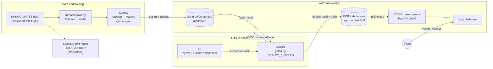

# Turbofan RUL: predictive maintenance with MLOps


Predicts the **remaining useful life (RUL)** of jet engines from sensor history
(NASA C-MAPSS, FD001), served as a containerised API and deployed to AWS by a
gated GitHub Actions pipeline.

**What this project demonstrates**

- **Reproducible training:** DVC pipelines and versioned data, MLflow tracking and a model registry with a promotion gate (`@champion`).
- **Tested serving:** FastAPI with validated inputs, pytest and a Docker smoke test.
- **Continuous deployment:** a push to `main` runs CI, then deploys to AWS ECS. AWS access uses short-lived OIDC credentials, with no stored keys.
- **Drift monitoring:** an Evidently report comparing FD001 with FD002.

## Architecture

# Architecture


Images are tagged with the commit SHA, so any running service traces back to the exact commit that built it, and rollback means redeploying an older SHA.

## Deployment

A push to `main` runs CI. When CI succeeds, the **Deploy** workflow builds the
image from the tested commit and deploys it to **AWS ECS Express Mode**.

1. **Sign in with OIDC:** GitHub proves its identity to AWS with a short-lived
   token, so no AWS keys are stored in the repo. The IAM role trusts only this
   repository on `main`.
2. **Fetch the model** `models/v<N>` from S3 and check that its version matches
   the `MODEL_VERSION` variable.
3. **Build and push** the image to ECR, tagged with the commit SHA.
4. **Deploy** the image to ECS Express (load balancer, one Fargate task).


The deploy job takes about 17 minutes, most of it ECS creating the service and
load balancer.


### Live check

The deployed API reported `model_version` 7, the model fetched from S3:


`POST /predict` with five cycles of engine sensor readings:


### Cost control

Deployment is switched by the `DEPLOY_ENABLED` repository variable, and a manual
**Teardown** workflow deletes the service and its load balancer. The service
was torn down after testing, so the URLs in the screenshots are no longer live.

## Try the API

With the server running (`uvicorn turbofan.serve:app`):

```
curl.exe -X POST http://127.0.0.1:8000/predict -H "Content-Type: application/json" -d "@docs/sample_request.json"
```

```json
{"unit":1,"predicted_rul":122.8,"at_cycle":5,"model_version":7}
```

`docs/sample_request.json` holds five cycles of sample sensor readings. A healthy
engine near the start of its life predicts close to the 125-cycle cap.

## Design decisions

- **OIDC instead of stored AWS keys:** the deploy role is assumed with a short-lived
  token, and its trust policy pins the exact repository and branch. GitHub's
  subject claim includes numeric owner and repo IDs, so the policy matches those.
- **Least privilege:** the deploy role can only push to one ECR repo, read one
  S3 prefix, pass two named roles, and manage the ECS service.
- **Images tagged with the commit SHA:** every running service traces to a commit,
  and rollback means redeploying an older SHA. `latest` is never used.
- **The model is pinned:** `MODEL_VERSION` selects `models/v<N>` in S3, and the
  pipeline stops if the version inside the files doesn't match.
- **Deploy is gated and reversible:** `DEPLOY_ENABLED` switches deployment on,
  and a manual Teardown workflow removes everything that costs money.
- **Drift is a standalone check:** `python -m turbofan.drift` compares FD001
  with FD002 using Evidently and writes an HTML report and a JSON summary.

## Limitations and next steps

- **Retraining is manual.** There's no scheduled pipeline (for example Airflow);
  training, promotion and upload to S3 are run by hand.
- **Drift is not wired into deployment.** The report flags drift in all 15 sensors
  on FD002, but nothing acts on it automatically. Some of that comes from the six
  operating conditions in FD002, and `sensor_6` is near-constant and distorts
  scores.
- **One dataset, one task.** Trained on FD001 only.
- **Minimal serving setup.** One task, no autoscaling, no prediction logging or
  alerting.
- **Model quality** is checked by the promotion gate on validation RMSE only.

## Data findings (FD001)

- 6 sensors are constant across all engines and carry no information: 
- Strongest wear signals (correlation with RUL): 
- Sensors stay flat early in life; degradation appears in roughly the last 100–150 cycles,
  so RUL will be capped (~125) during feature engineering.
- Validation must split by engine

## Features (FD001)

- RUL capped at 125 (sensors show no wear signal above this).
- For each of 15 sensors: raw value, 10-cycle rolling mean, 10-cycle rolling std (per engine,
  past-only) → 45 features.
- Random forest, engine split, capped RUL: raw sensors RMSE 17.3 engineered RMSE 16.6

## Training

Run from the project root:

```
python -m turbofan.train
```

Trains a random forest on all 100 FD001 training engines and evaluates on NASA's
100 test engines (predicting at each engine's last recorded cycle).

- Test RMSE (true RUL):  20.58 cycles
- Test RMSE (capped at 125): 19.57 cycles

## Reproducing the model

```
git clone https://github.com/Amir-karki/predictive-maintenance-mlops.git
dvc pull        # fetch the data and model
dvc repro       # rebuild the model if anything changed
```

## Experiment tracking

Experiments are tracked with MLflow (local SQLite store). To view them: mlflow ui --backend-store-uri sqlite:///mlflow.db

Then open http://127.0.0.1:5000.

## Running experiments

All settings live in `params.yaml`. To try new settings:

1. Edit `params.yaml`
2. Run `dvc repro` (trains, evaluates and logs an MLflow run)
3. Compare runs in the MLflow UI, sorted by `val_rmse`

## Model registry

Every training run registers a new version of `turbofan-rul` in MLflow.
To decide whether it goes to production:

    python -m turbofan.promote

It becomes `@champion` only if its `val_rmse` beats the current champion's.
Services load the production model from `models:/turbofan-rul@champion`.

## Tuning

    python -m turbofan.tune

Searches model settings with Optuna and logs every trial to the
`rul-fd001-tuning` MLflow experiment. Copy the printed best settings into
`params.yaml`, then run `dvc repro` and `python -m turbofan.promote`.

## Serving

Start the prediction API from the project root:

    uvicorn turbofan.serve:app --reload

It loads `models:/turbofan-rul@champion` at startup. Interactive docs are at
http://127.0.0.1:8000/docs. `POST /predict` takes an engine's recent cycle
history and returns its predicted remaining useful life.

## Docker

Export the current champion and build an image tagged with its version:

    python -m turbofan.export
    docker build -t turbofan-api:v<version> .
    docker run --rm -p 8000:8000 turbofan-api:v<version>

The image contains the model, so it runs without the MLflow registry.

## Tests

    python -m pytest -v

`tests/test_api.py` uses a fake model and runs anywhere.
`tests/test_real_model.py` checks the exported champion and skips if
`build/champion` or `data/raw` is missing.

## Continuous integration

`.github/workflows/ci.yml` runs on every push to `main` and every pull request:

1. **Unit tests**: installs `requirements-ci.txt` (serving dependencies plus pytest)
   and runs the test suite. Tests that need the real model or data are skipped.
2. **Image build and smoke test**: builds the Docker image around a stand-in model
   (`ci/make_standin_model.py`), starts it, and checks `/health` and `/predict`
   from outside (`ci/smoke_test.py`).

CI proves the code, image and API contract work. Model quality is checked by the
promotion gate, and real-model parity by `tests/test_real_model.py`.